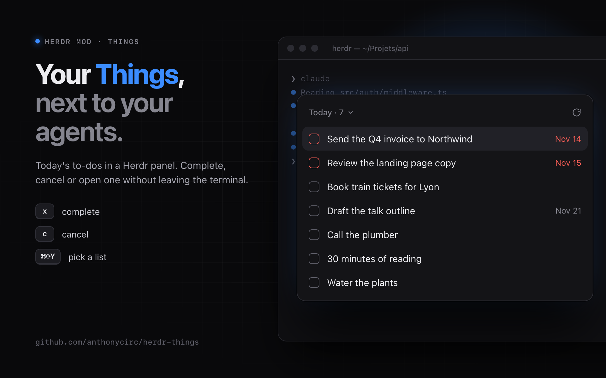
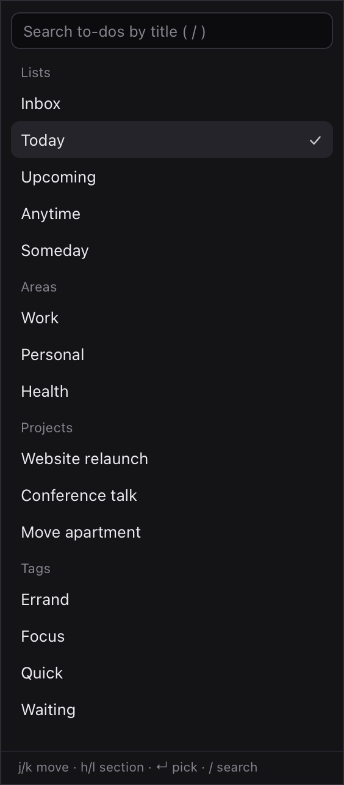

# herdr-things

A [Herdr](https://herdr.dev) desktop mod that shows your [Things 3](https://culturedcode.com/things/)
to-dos in a panel, next to your terminals and agents. Click a to-do's box to
complete it, ⌥-click it (or click the ✕ on hover) to cancel a to-do you won't
do, click its title to open it in Things, click the header to pick
which list to show.



It talks to the Things app on your Mac through AppleScript (`osascript`), so
the mod stores no token and needs no password: Things itself is the source.

## Requirements

- Herdr desktop app, on macOS
- Things 3 for Mac, open. The panel never launches Things: when it is closed,
  the panel says so.
- The first read asks macOS to let Herdr control Things. Allow it. If you
  declined, turn it back on in **System Settings → Privacy & Security →
  Automation → Herdr → Things3**; the panel shows this hint when access is
  denied.

No Full Disk Access is needed: the mod never reads the Things database file.

## Install

### With the Herdr app's agent

Ask the agent in Herdr:

> Read ~/.config/herdr-app/AGENTS.md, then add this mod:
> https://github.com/anthonycirc/herdr-things

It follows [`RECIPE.md`](RECIPE.md).

### By hand

1. Copy the mod into Herdr's home:

   ```sh
   git clone https://github.com/anthonycirc/herdr-things
   cp -R herdr-things/mods/things ~/.config/herdr-app/mods/
   ```

2. Add a block to your layout (`~/.config/herdr-app/layouts/<name>.json`).
   Herdr's own layouts can't be edited: clone one first (`layout.clone`).
   For example, under the agents list in the sidebar's `sidebar-lists` column:

   ```json
   { "id": "things", "type": "block", "content": { "mod": "things" }, "size": { "weight": 1 }, "min": 90 }
   ```

3. Check it:

   ```sh
   herdr-app check ~/.config/herdr-app/mods/things
   ```

## Pick a list

Click the header (`Today · 7 ⌄`) to choose what the panel shows:

- **Lists**: Inbox, Today (default), Upcoming, Anytime, Someday
- **Areas**: your Things areas
- **Projects**: your open projects
- **Tags**: your Things tags
- **Search**: type words in the field at the top and press Enter to list the
  open to-dos whose title contains them

Lists are read by their Things id, so they work whatever language Things is in.

The picker works from the keyboard:

| Key                      | What it does                         |
|--------------------------|--------------------------------------|
| `j` / `k`, `↓` / `↑`     | Next / previous item                 |
| `h` / `l`                | Previous / next section              |
| `g` / `G`                | First / last item                    |
| `Enter`                  | Show the selected list               |
| `/` or `i`               | Type a search (`↓`/`↑`, `ctrl-j`/`ctrl-k` still move) |
| `Esc`                    | Leave the search field, then close   |



The choice is kept across restarts. The refresh icon spins while the list is
read; its tooltip says when it was last updated.

## What a row shows

The to-do's title, and its deadline on the right when it has one, red once
the deadline is today or past (its box turns red too). Hover the title to see
its project or area.

Hovering a row shows a ✕ on the right: it cancels the to-do, as Things'
"won't do". ⌥-clicking the box does the same. A canceled to-do is struck
through until the list is read again, then it leaves the list for Things'
logbook.

## Configure

Set `props` on the block. All of them are optional.

| Prop      | Default     | What it does                                                        |
|-----------|-------------|---------------------------------------------------------------------|
| `list`    | `"today"`   | The list shown until one is picked: `inbox`, `today`, `upcoming`, `anytime`, `someday` |
| `refresh` | `60`        | Seconds between reads (minimum 15)                                  |
| `key`     | `"default"` | Keeps each panel's pick apart when several are shown                |

Two panels side by side:

```json
{ "id": "things-inbox", "type": "block", "content": { "mod": "things", "props": { "key": "inbox", "list": "inbox" } } }
```

## Keyboard in the panel

The panel takes the keyboard like a pane: `pane.go` reaches it, for example
`ctrl-h` from the terminal next to the sidebar (`"ctrl-h": "pane.go:left"`).

| Key              | What it does                     |
|------------------|----------------------------------|
| `j` / `k`        | Next / previous to-do            |
| `g` / `G`        | First / last to-do               |
| `x` or `Space`   | Complete the selected to-do      |
| `c`              | Cancel it (won't do)             |
| `Enter` or `o`   | Open it in Things                |
| `r`              | Refresh                          |
| `/` or `m`       | Pick a list                      |
| `l` or `Esc`     | Back to the pane on the right    |

## Commands and keys

| Command          | What it does              |
|------------------|---------------------------|
| `things.refresh` | Reads the list again      |
| `things.menu`    | Opens the list picker     |

This repo's [`keys.json`](keys.json) binds `cmd-shift-y` to `things.menu`; merge it into
`~/.config/herdr-app/keys.json` (the agent does it when it adds the mod). For
example:

```json
{ "global": { "cmd-shift-y": "things.menu" } }
```

## What it runs

- `osascript -l JavaScript` with the script in `main.js`, which asks the
  Things app for a list's open to-dos on each refresh, for the areas,
  projects and tags when the list picker opens, and sets a to-do's status to
  completed or canceled when you complete or cancel it
- `open things:///show?id=<id>` when you open a to-do

Everything runs on the local machine and needs the Things Mac app, so a remote
Herdr machine without Things shows the "isn't installed" note.

## Uninstall

Remove the block from your layout and delete `~/.config/herdr-app/mods/things`.

## License

MIT
