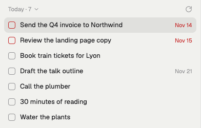
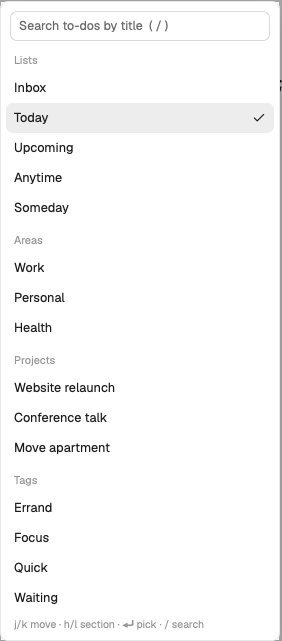

# things

A panel of your Things 3 to-dos, Today by default, in your existing Herdr
window. Each row has a box that completes the to-do and a title that opens it
in Things.

## What you see

- A panel with a 41px header: the list's label and to-do count (`Today · 7`)
  with a 12px chevron at 11.5px in `dim`, and a 14px refresh icon on the
  right that spins (900 ms) in `foreground` while the list is read.
- 30px rows, 8px rounded, `hover` background: a 14px box (4px radius) with a
  1.5px `dim` border, the to-do title in `foreground`, truncated, and its
  deadline (`Nov 20`) at 11px in `dim`. A deadline today or
  past turns the date and the box border `ansi1`. The title's tooltip names
  its project or area.
- Rows keep Things' own order.
- `chrome` background with a top `border`, so it sits like the sidebar's
  other lists. Empty: "Nothing to do." Things closed: "Things isn't open."
  Things missing: "Things 3 isn't installed." Automation denied: the
  osascript error, then the System Settings hint in `dim`.

## How it behaves

- Reads to-dos on start, every `refresh` seconds (default 60, minimum 15) and
  when the refresh icon is clicked. Only open to-dos; projects are left out.
- Hovering a box fills it. Clicking it completes the to-do (its AppleScript
  `status` set to `completed`), greys the row while pending, then reads the
  list again.
- Clicking a title opens the to-do (`open things:///show?id=<id>`).
- Clicking the header opens a 280x440 popup: a search input (Enter lists the
  open to-dos of Inbox, Today, Upcoming, Anytime and Someday whose title
  contains the text, case-insensitive), then Lists (Inbox, Today, Upcoming,
  Anytime, Someday), Areas, Projects (open ones) and Tags, the current one
  checked. A pick is saved with `setShared("things.view.<key>")`, closes the
  popup and runs `things.refresh`.
- The picker opens with the list focused and the current list selected
  (`selected` background). `j`/`k` and arrows move, `h`/`l` jump to the
  previous/next section, `g`/`G` to the ends, Enter picks, `/` or `i` focus
  the search input (`accent` border), where arrows and `ctrl-j`/`ctrl-k`
  still move and Esc returns to the list; Esc on the list closes. The
  selection scrolls into view (`ScrollHandle.scroll_to_item`, counting the
  section headers). A 10.5px `dim` footer lists the keys.

  
- Commands: `things.refresh` reads again; `things.menu` opens the picker as
  a dialog (a command has no pointer to anchor a popup).
- One read at a time: a refresh during a read runs once it ends.
- `mod.json` has `"focusable": true`: `pane.go` gives the panel the keyboard
  (it gets `"focus"` from `nextCommand()` and focuses its handle). Focused,
  the selected row has the `selected` background and a 10.5px `dim` footer
  lists the keys: `j`/`k`, `g`/`G`, `x`/Space complete, Enter/`o` open, `r`
  refresh, `/`/`m` the picker (as a dialog), `l`/Esc `pane.go` right.
- A failed read shows its error in `ansi1` above the list. It keeps the last
  rows of the same list, and clears them when the failing list is a new one
  or Things is closed.

## Built from

- `mods/things/main.js`: one `View`. Imports `View`, `div`, `svg` from
  `gpui-kit`; `v_flex`, `h_flex`, `InputState`, `Input` from `gpui-base`;
  `exec`, `theme`, `props`, `shared`, `setShared`, `openOverlay`,
  `closeOverlay`, `nextCommand`, `run` from `herdr`. `mod.json`:
  `{ "place": "none", "focusable": true }`.
- Block props: `list` (`inbox`, `today`, `upcoming`, `anytime`, `someday`;
  default `today`), `refresh` (seconds), `key` (shared-state key).
- A JXA script kept in `main.js` and run with
  `exec("osascript", ["-l", "JavaScript", "-e", SCRIPT, ...argv])`. Its
  commands: `list <list|project|area|tag> <id or tag name>`, `search <text>`,
  `sources`, `complete <id>`. It prints JSON, and `{ "closed": true }` when
  Things isn't running (it never launches the app). Icons: `refresh.svg`,
  `chevron-down.svg`, `check.svg`. The popup is the same mod with
  `props.menu`.
- No network access, no token, no password, no Full Disk Access: the Things
  app answers.
- `keys.json`: `{ "global": { "cmd-shift-y": "things.menu" } }`, merged into the person's keys
  only where the key is free.

## Watch out

- Built-in lists are read by id (`TMInboxListSource`, `TMTodayListSource`,
  `TMCalendarListSource`, `TMNextListSource`, `TMSomedayListSource`): their
  names follow the app's language, so `lists.byName("Today")` fails on a
  French Things (error -1728).
- Read properties in bulk (`toDos.name()`, `toDos.id()`, …): one Apple event
  per property, not per row. `toDos.class()` in bulk fails (-1728): projects
  are left out by id instead.
- `Application("Things3")` launches Things when it isn't running: check
  `running()` first.
- osascript error codes: -1743 Automation denied, -1728 object not found
  (a deleted project or area), -10814 or "can't be found" Things missing.
- Don't keep a `cx`: the refresh and complete tasks take their own from
  `cx.spawn`.
- Herdr's shipped layouts can't be edited: add the block to a clone.
- Saving a file reloads the mod in place but the `nextCommand` loop doesn't
  restart: commands reach it again after a fresh start (app restart or a
  layout switch).

## Done when

- `herdr-app check ~/.config/herdr-app/mods/things` passes.
- The panel lists the same to-dos as Things' Today list.
- Clicking a box completes that to-do in Things and the row disappears.
- Clicking a title opens the to-do in Things.
- With a `list` prop, the panel shows that list.
- Picking an area, a project or a tag in the header popup lists its to-dos
  and survives a restart; typing a search and Enter lists the matches.
- `things.refresh` spins the refresh icon; `things.menu` opens the picker.
- With Things closed, the panel says "Things isn't open." instead of an
  error.
